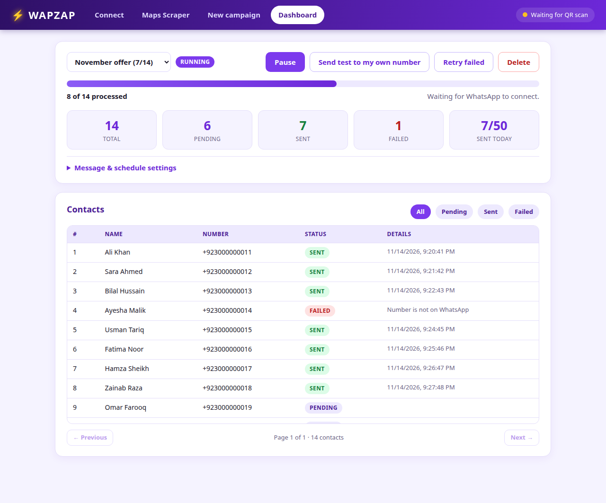
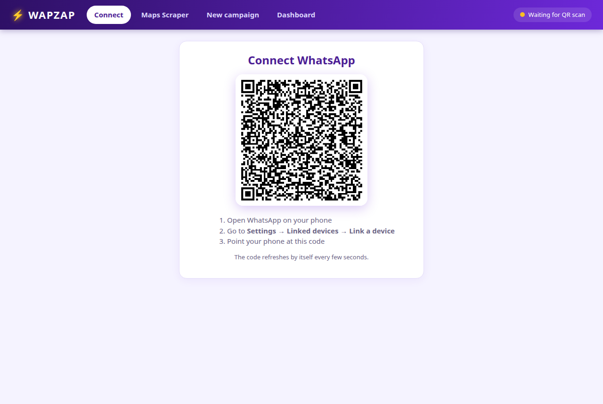
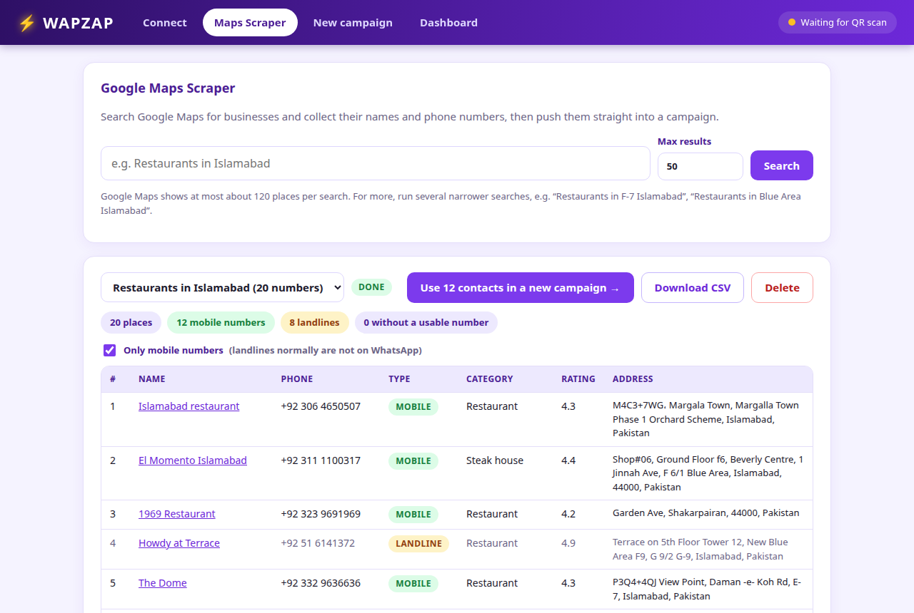
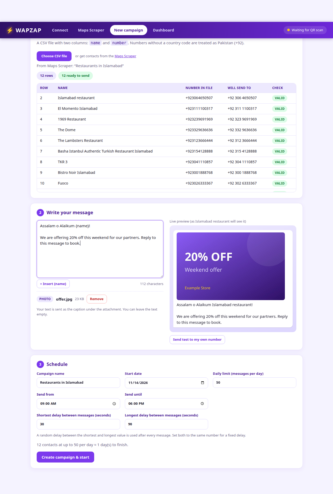

# ⚡ WAPZAP

A local web app for sending personalised WhatsApp messages in bulk, with a built-in Google Maps scraper for finding business contacts.

WAPZAP runs entirely on your own computer. It links to your WhatsApp account the same way WhatsApp Web does (by scanning a QR code), sends messages slowly on a schedule you control, and stores everything in a local SQLite database.



## Features

- **WhatsApp connect page** – scan a QR code in the browser once; the session is saved and survives restarts.
- **CSV contact upload** – columns `name` and `number`. Rows are previewed, numbers are validated and normalised to international format (default country Pakistan, +92), and duplicates and invalid rows are flagged.
- **Message editor** – `{name}` placeholder with a live preview.
- **Attachments** – send a photo, video or document with the text as its caption, or record a voice message in the browser. Files are converted to formats WhatsApp plays on every phone.
- **Campaign scheduling** – daily limit (default 50), sending window (start and end time) and start date. A campaign continues on the following days until the list is done.
- **Random delay** – 30–90 seconds between messages by default; both ends are adjustable.
- **Dashboard** – per-contact status (pending / sent / failed), progress, pause and resume, retry failed, and a "send test to my own number" button.
- **Google Maps Scraper** – search for something like "Restaurants in Islamabad", collect names and phone numbers, and push them into a new campaign in one click.
- **Restart-safe** – campaigns, contacts, progress and the WhatsApp session are all stored on disk.

## Screenshots

| Connect | Google Maps Scraper |
|---|---|
|  |  |

**New campaign** – contacts, message with attachment, live preview and schedule:



## Requirements

- Linux (built and tested on Ubuntu, 64-bit Intel/AMD)
- [Node.js](https://nodejs.org) 22.13 or newer (uses the built-in `node:sqlite` module)
- `ffmpeg` – for voice messages and video/image conversion
- Google Chrome or Chromium – only for the Maps Scraper

## Run from source

```bash
git clone https://github.com/xafar786/wapzap.git
cd wapzap
npm install
npm start
```

Then open <http://localhost:3000>. Press `Ctrl+C` in the terminal to stop.

| Setting | How to change it | Default |
|---|---|---|
| Port | `PORT=4000 npm start` | `3000` |
| Data folder | `WAPZAP_DATA_DIR=/some/folder npm start` | `./data` |
| Chrome location | `WAPZAP_CHROME=/path/to/chrome npm start` | auto-detected |

## Install on Ubuntu as an app

Build a self-contained `.deb` package (it bundles its own copy of Node.js):

```bash
npm install
npm run build:deb
sudo apt install ./dist/wapzap_*_amd64.deb
```

This adds a **WAPZAP** entry to the applications menu and a `wapzap` command:

| Command | What it does |
|---|---|
| `wapzap` | Starts the app in the background and opens it in the browser (<http://localhost:3210>) |
| `wapzap stop` | Stops the app; campaigns continue when it is started again |
| `wapzap status` | Says whether it is running |
| `wapzap logs` | Shows the last lines of the log |

The installed app keeps its data in `~/.local/share/wapzap`. Uninstall with `sudo apt remove wapzap`; the data folder is left in place.

## How to use it

1. **Connect** – open WhatsApp on your phone → Settings → Linked devices → Link a device, and scan the QR code.
2. **Get contacts** – upload a CSV (see [`sample-contacts.csv`](sample-contacts.csv)) or run a search in the **Maps Scraper** and press *Use contacts in a new campaign*.
3. **Write the message** – use `{name}` where the contact's name should go, optionally add an attachment, and send a test to your own number.
4. **Schedule** – set the daily limit, sending window, start date and delays, then create the campaign.
5. **Watch the dashboard** – it shows what has been sent and why the campaign is waiting (outside the window, daily limit reached, and so on).

### CSV format

```csv
name,number
Ali Khan,0300 1234567
Sara Ahmed,+92 321 7654321
```

Numbers may be written locally (`0300…`), internationally (`+92…`, `0092…`, `92…`) or with the leading zero missing (`300…`).

### Good to know

- The computer must be on and the app running for messages to go out.
- A campaign starts as soon as it is created, within its start date and sending window.
- If the app stops in the middle of a send, that contact is marked *failed* rather than retried automatically, to avoid sending the same message twice.
- One attachment per campaign. A voice message is sent first, with the text following as a second message.
- The Maps Scraper returns at most about 120 places per search (a Google Maps limit). Landlines are excluded from campaigns by default because they are normally not on WhatsApp.

## Project layout

```
server.js            Express server and API routes
src/db.js            SQLite schema and helpers
src/whatsapp.js      WhatsApp connection and sending (Baileys)
src/scheduler.js     Sending loop: window, daily limit, delays
src/csv.js           CSV parsing and phone number normalisation
src/media.js         Attachment storage and ffmpeg conversion
src/scraper.js       Google Maps scraper (puppeteer-core)
public/              Frontend (plain HTML, CSS and JavaScript)
packaging/           Ubuntu .deb build script, launcher and icon
```

Built with [Baileys](https://github.com/WhiskeySockets/Baileys), Express, `node:sqlite`, [libphonenumber-js](https://gitlab.com/catamphetamine/libphonenumber-js) and [puppeteer-core](https://pptr.dev).

## Use responsibly

- WAPZAP uses an unofficial WhatsApp client. It is not affiliated with or endorsed by WhatsApp or Meta, and automated or bulk messaging can get a number restricted or banned. Keep daily limits low and message only people who expect to hear from you.
- Scraping Google Maps is against Google's terms of service, and the scraper depends on the current layout of Google's pages, so it may stop working when that changes.
- You are responsible for complying with the laws on unsolicited messages and data protection that apply to you.
